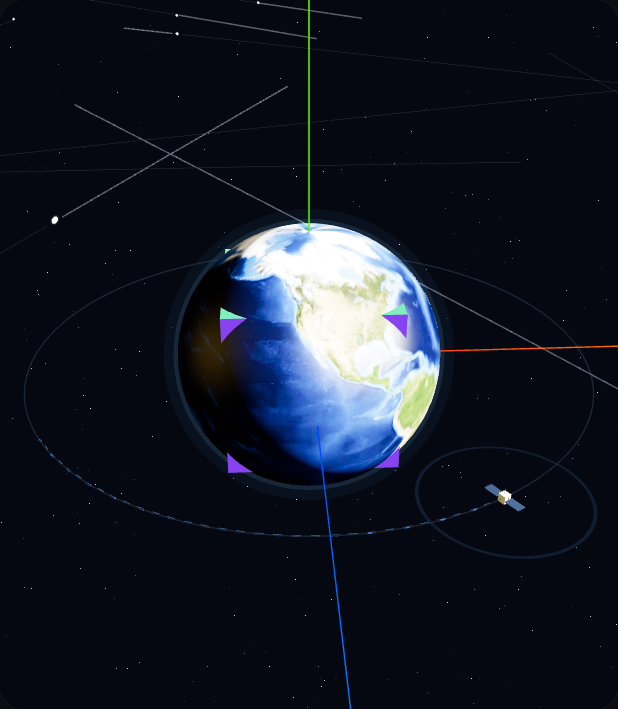
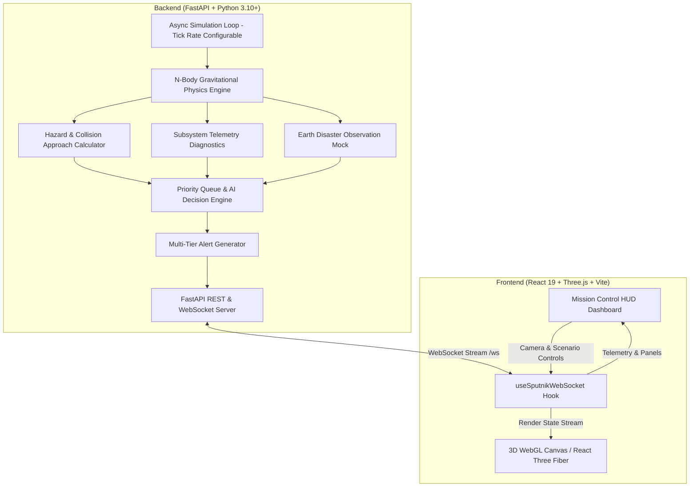

# 🛰️ Sputnik AI — Autonomous Satellite Mission Control & Orbital Intelligence Platform

<div align="center">

[](https://fastapi.tiangolo.com)
[](https://python.org)
[](https://react.dev)
[](https://threejs.org)
[](https://vitejs.dev)
[](https://websockets.readthedocs.io)
[](LICENSE)

**An intelligent, autonomous orbital mission-control digital twin featuring real-time 3D Earth-orbit visualization, n-body gravitational mechanics, predictive collision avoidance, solar weather triage, and AI-driven telemetry diagnostics.**

[Overview](#-overview) • [Key Features](#-key-features) • [System Architecture](#-system-architecture) • [Demo Scenarios](#-demo-scenarios) • [Quick Start](#-quick-start) • [Security & Engineering](#-security--engineering) • [License](#-license)

---



</div>

---

## 🌌 Overview

**Sputnik AI** is a full-stack, autonomous space mission control platform designed to monitor, protect, and guide low-Earth orbit (LEO) satellite systems in real time.

Modern orbital environments are increasingly crowded with orbital debris, extreme space weather events (geomagnetic storms, solar radiation flares), and dynamic earth-observation mission priorities. **Sputnik AI** bridges high-fidelity 3D spatial awareness with autonomous backend decision-making:

- **Physics-Informed Digital Twin:** Models satellite trajectories and space debris vectors influenced by Earth, Moon, and Sun gravitational perturbations.
- **Predictive Hazard Avoidance:** Calculates Closest Approach Distances (CAD) and Time-to-Closest-Approach (TCA) across multiple trajectory steps, automatically planning evasive thruster burns.
- **Solar Storm Triage:** Evaluates real-time solar flux, coronal mass ejection (CME) risks, and magnetosphere interference to dynamically adapt power and communications subsystems.
- **Earth Disaster Observation:** Simulates continuous satellite payload imagery processing to detect regional emergencies (wildfires, floods, industrial catastrophes) across Uzbekistan with probabilistic confidence metrics.
- **Priority-Based AI Decision Engine:** Weighs concurrent health anomalies, orbital risks, and mission objectives to trigger automated commands (`EVADE`, `SAFE MODE`, `ORBIT ADJUST`, `LOAD SHEDDING`, `ACTIVE SURVEILLANCE`).

---

## ✨ Key Features

### 1. 🌍 Interactive 3D WebGL Digital Twin (Three.js / React Three Fiber / Drei)
- **High-Definition Textured Earth:** Utilizes NASA Blue Marble surface textures, high-resolution topography normal maps, and specular water reflections with atmospheric glow.
- **Live Celestial Mechanics:** Orbit ring representation, satellite orientation, dynamic Moon orbit, and directional Sun illumination.
- **Trajectory Forecast Visualizer:** Visualizes predicted path arcs, orbital past history trails, and proximity threat spheres for incoming space debris.
- **Fluid Camera Choreography:** Smooth orbital controls with target focus, zoom limits, and tactile inspection angles.

### 2. ⚡ Real-Time Physics & Gravitational Perturbation Engine (Python / FastAPI)
- **N-Body Gravity Perturbation:** Implements calibrated gravitational acceleration vectors derived from Earth, Moon, and distant Sun bodies.
- **Tangential Fly-by Dynamics:** Tuned trajectories ensuring 90% of celestial objects pass on realistic hyperbola/elliptical arcs while 10% present convergence risks.
- **Earth Safety Boundary:** Strict collision boundary thresholds preventing impossible underground orbital paths.
- **Dynamic Closest Approach Calculation:** Real-time multi-step lookahead computing minimum static distances, projected intercept times, and composite hazard scores (0–100).

### 3. 🧠 Autonomous AI Decision & Priority Queue Engine
- **Multi-Threat Priority Queue:** Aggregates and sorts events from telemetry monitors, proximity alerts, solar weather warnings, and Earth observation payloads.
- **Unified Decision Resolution:** Synthesizes concurrent operational mandates:
  - `UKLONISH` (Autonomous Evasive Burn): Triggered upon critical collision probability.
  - `ORBITA MOSLASHUVI` (Orbit Adjustment): Corrective maneuvers for converging vectors.
  - `XAVFSIZ REJIM` (Safe Mode): Thermal regulation and subsystem preservation during overheating.
  - `YUKLAMANI KAMAYTIRISH` (Load Shedding): Battery conservation during high solar interference or eclipse phases.
  - `FAOL KUZATUV` (Active Observation): Repositioning payloads for ground emergency monitoring.

### 4. 🛰️ Telemetry Health & Environmental Diagnostics
- **Power Subsystem:** Live battery charge/drain modeling based on solar panel orientation and solar charging rates.
- **Thermal Management:** Core temperature tracking with ambient space equilibrium calculations.
- **Communications Link:** Downlink quality, signal attenuation, and transmitter/receiver integrity.
- **Solar Storm Telemetry:** Solar flux index, geomagnetic disturbance levels (Low, Elevated, High, Critical), and communications blackout predictions.

### 5. 📡 High-Throughput WebSocket Streaming
- Single-duplex/bi-directional state broadcasting at configurable simulation frequencies (1x, 2x, 5x speed).
- Resilient client-side reconnect handling with graceful fallbacks.

---

## 🏛️ System Architecture



---

## 📁 Repository Structure

```
Sputnik/
├── backend/                        # FastAPI simulation backend
│   ├── alerts.py                   # Multi-tier alert generation logic
│   ├── decision.py                 # Autonomous AI decision & priority queue engine
│   ├── earth_mock.py               # Earth disaster vision detection simulation
│   ├── main.py                     # FastAPI server, REST routes & WebSocket broadcaster
│   ├── monitors.py                 # Closest approach (CAD/TCA) & health analyzers
│   ├── requirements.txt            # Python dependencies (FastAPI, Uvicorn, Pydantic, WebSockets)
│   ├── schemas.py                  # Pydantic v2 data models & validation schemas
│   ├── simulator.py                # Orbital mechanics, gravitational physics & scenarios
│   ├── test_ws.py                  # Standalone WebSocket connection verification script
│   └── .env.example                # Configuration template
│
├── frontend/                       # React 19 + Three.js + Vite application
│   ├── public/                     # Static assets
│   │   └── textures/               # High-res Earth textures (Blue Marble, topology, water)
│   ├── src/
│   │   ├── components/             # Modular dashboard & 3D components
│   │   │   ├── SpaceScene3D.jsx    # WebGL canvas, lights, camera & celestial system
│   │   │   ├── EarthGlobe.jsx      # Textured Earth mesh & atmospheric shader
│   │   │   ├── SatelliteModel.jsx  # Satellite body, solar arrays & thruster effects
│   │   │   ├── OrbitRing.jsx       # Projected orbital ring trajectory
│   │   │   ├── HazardField.jsx     # Debris objects, danger vectors & fly-by arcs
│   │   │   ├── SatelliteStatusPanel.jsx # Power, temperature & comms telemetry
│   │   │   ├── AIDecisionPanel.jsx # AI autonomous decisions & reasoning display
│   │   │   ├── AlertsPanel.jsx     # Real-time incident logs
│   │   │   ├── EarthMonitorPanel.jsx # Natural disaster tracking (Uzbekistan regions)
│   │   │   ├── PriorityQueuePanel.jsx # Real-time triage ranking
│   │   │   ├── SolarWeatherPanel.jsx  # Space weather & solar flare telemetry
│   │   │   └── SystemActionsPanel.jsx # Mission command controls & scenario switches
│   │   ├── pages/
│   │   │   └── Dashboard.jsx       # Master mission control layout
│   │   ├── services/
│   │   │   └── api.js              # WebSocket connection manager & REST client
│   │   ├── App.jsx                 # Application root
│   │   ├── index.css               # Tailored dark-mode space design tokens
│   │   └── main.jsx                # React DOM entry
│   ├── package.json                # Frontend dependencies & build scripts
│   └── vite.config.js              # Vite server & API proxy configuration
│
├── assets/                         # Documentation visual assets
│   └── preview-3d.png              # 3D digital twin preview capture
├── .gitignore                      # Comprehensive production gitignore
├── LICENSE                         # MIT License
└── README.md                       # Complete documentation
```

---

## 🎮 Demo Scenarios

Sputnik AI comes pre-configured with scenario presets allowing instant verification of autonomous responses:

| Scenario | Objective | Autonomous AI Action |
|:---|:---|:---|
| **Demo 1: Nominal Orbit** | Standard orbital patrol with normal planetary observations and solar array charging. | `NORMAL REJIM` — Routine diagnostic sweeps, uninterrupted earth surveillance. |
| **Demo 2: Meteoroid Convergence** | High-velocity orbital debris converging directly into the satellite's safety corridor ($T < 10$ ticks). | `UKLONISH` — Immediate thruster burn initiation, orbit perturbation, vector clearance. |
| **Demo 3: Combined Threat** | Critical solar storm burst coinciding with secondary debris fly-by and thermal spikes. | `UKLONISH + XAVFSIZ REJIM + YUKLAMANI KAMAYTIRISH` — Simultaneous evasion, subsystem thermal throttling, and payload power shedding. |

---

## 🚀 Quick Start

### Prerequisites
- **Python**: 3.10 or higher
- **Node.js**: 18.0 or higher (`npm` included)

---

### 1. Backend Setup (FastAPI)

```bash
# Navigate to the backend directory
cd backend

# Create a virtual environment
python -m venv venv

# Activate the virtual environment
# Windows (PowerShell):
.\venv\Scripts\Activate.ps1
# Windows (Command Prompt):
.\venv\Scripts\activate.bat
# Linux / macOS:
source venv/bin/activate

# Install dependencies
pip install -r requirements.txt

# Start the simulation & API server
python -m uvicorn main:app --host 127.0.0.1 --port 8000 --reload
```

The backend server will start on `http://127.0.0.1:8000`.
- **Interactive OpenAPI Docs:** `http://127.0.0.1:8000/docs`
- **WebSocket Endpoint:** `ws://127.0.0.1:8000/ws`

---

### 2. Frontend Setup (React + Vite)

Open a new terminal window:

```bash
# Navigate to the frontend directory
cd frontend

# Install dependencies
npm install

# Start Vite development server
npm run dev
```

The frontend dashboard will be available at: **`http://localhost:5173/`**

---

### 3. Production Build

To build the client for production deployment:

```bash
cd frontend
npm run build
```

Production assets are bundled into `frontend/dist/`.

---

## 📡 API Reference

### REST Endpoints

| Method | Endpoint | Description |
|:---|:---|:---|
| `GET` | `/api/status` | System health check (`{"system": "Orbital Guardian AI", "status": "running"}`) |
| `GET` | `/api/full-state` | Fetch the full current simulation snapshot including positions, risks, and telemetry |
| `POST` | `/api/simulate-step` | Manually advance the simulation forward by 1 tick |
| `POST` | `/api/reset` | Restore initial orbital conditions and clear threats |
| `POST` | `/api/scenario` | Switch scenario (`nominal`, `meteoroid`, `combined`) |
| `POST` | `/api/speed` | Update simulation multiplier (1x, 2x, 5x) |

### WebSocket Protocol (`/ws`)

Upon connection, the server immediately pushes the complete snapshot and continuously streams updated payloads on every tick (1 Hz nominal):

```json
{
  "scenario_id": "meteoroid",
  "satellite": { "x": 35.3, "y": 35.3, "angle": 45.0, "speed": 6.0 },
  "telemetry": { "battery": 94.2, "temperature": 46.1, "communication": 82.5 },
  "solar_weather": { "flux": 115.0, "level": "elevated", "interference": 15.0 },
  "collision_risk": "critical",
  "nearest_hazard_id": "METEOR-07",
  "nearest_hazard_distance": 8.4,
  "time_to_closest_approach": 3,
  "decision": "UKLONISH",
  "reason": ["Sun'iy yo'ldosh to'qnashib ketishi mumkin..."],
  "avoidance_active": true,
  "step": 42
}
```

---

## 🔒 Security & Engineering Highlights

- **Zero Hardcoded Credentials:** The entire architecture is clean of API keys, hardcoded tokens, personal emails, or database passwords. All configuration is self-contained or externalized via `.env.example`.
- **In-Memory Thread-Safe State:** Self-contained deterministic simulation without external database dependencies, preventing database injection vectors and state corruption.
- **Strict Data Contracts:** Pydantic v2 schemas enforce validation and typing on all incoming and outgoing payloads.
- **Cross-Origin Security:** CORS middleware configured with explicit origin controls.
- **WebSocket Concurrency Protection:** Broadcast loop prevents concurrent race conditions on open client sockets.

---

## 🛣️ Roadmap

- [ ] **Orbital Decay Physics:** Integration of atmospheric drag models in very low Earth orbit (VLEO < 300 km).
- [ ] **Multi-Constellation Support:** Visualizing satellite constellations (Starlink / OneWeb mesh topologies).
- [ ] **Ground Station Downlink Pass Prediction:** Computing elevation angles and visibility windows for tracking dishes.
- [ ] **Post-Processing Glow Shaders:** Custom GLSL bloom and volumetric raymarching for solar coronas.

---

## 📄 License

Distributed under the **MIT License**. See [`LICENSE`](LICENSE) for details.

---

<div align="center">
  <b>Developed by <a href="https://github.com/magus24">magus24</a></b><br>
  <sub>Autonomous Systems • Aerospace Computing • Creative WebGL</sub>
</div>
