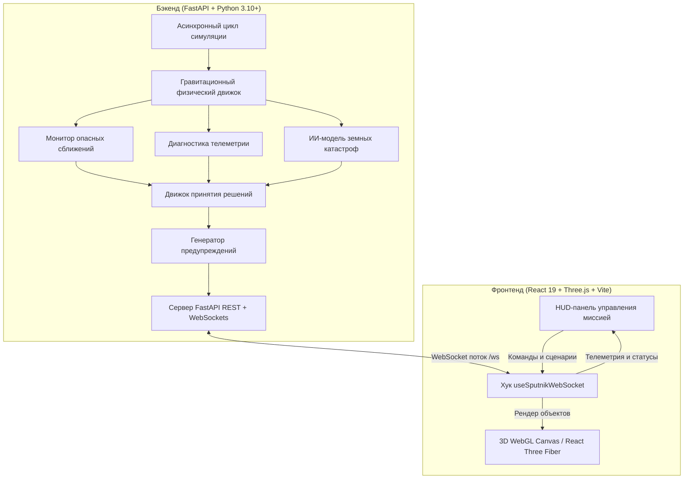

# 🛰️ Sputnik AI — Автономный центр управления спутником и орбитальный интеллект

<div align="center">

[](https://fastapi.tiangolo.com)
[](https://python.org)
[](https://react.dev)
[](https://threejs.org)
[](https://vitejs.dev)
[](https://websockets.readthedocs.io)
[](LICENSE)

**Интеллектуальный автономный цифровой двойник орбитальной миссии с 3D-визуализацией околоземного пространства в реальном времени, гравитационной физикой N-тел, предиктивным уклонением от космического мусора, мониторингом космической погоды и ИИ-диагностикой телеметрии.**

[English Version](README.md) • [О проекте](#-о-проекте) • [Ключевые возможности](#-ключевые-возможности) • [Архитектура](#-архитектура) • [Сценарии симуляции](#-сценарии-симуляции) • [Быстрый старт](#-быстрый-старт) • [Безопасность](#-безопасность) • [Лицензия](#-лицензия)

---


</div>

---

## 🌌 О проекте

**Sputnik AI** — это полнофункциональный комплекс автономного управления космическим аппаратом на низкой околоземной орбите (НОО).

Космическое пространство становится всё более перегруженным техногенным мусором и подвержено резким изменениям космической погоды (вспышки солнечной активности, геомагнитные бури). **Sputnik AI** объединяет интерактивную 3D-пространственную среду высокой точности с предиктивным физико-математическим ядром и автономным движком принятия решений:

- **Гравитационный цифровой двойник:** моделирование орбитального движения и траекторий космического мусора с учётом гравитационных возмущений Земли, Луны и Солнца.
- **Предиктивное уклонение от угроз:** расчёт точек минимального сближения (Closest Approach) и времени до перехвата (TCA) с автоматическим запуском маневров уклонения.
- **Мониторинг космической погоды:** оценка солнечного потока (solar flux), риска корональных выбросов массы (CME) и электромагнитных помех для адаптации систем питания и связи.
- **Спутниковое обнаружение природных ЧС:** симуляция работы бортовой оптической полезной нагрузки для выявления очагов пожаров, наводнений и разрушений по регионам Узбекистана с вероятностной оценкой достоверности.
- **Приоритетный ИИ-арбитр:** объединение аномалий телеметрии, баллистических угроз и задач наблюдения в единую очередь приоритетов с выработкой директив управления (`UKLONISH`, `ORBITA MOSLASHUVI`, `XAVFSIZ REJIM`, `YUKLAMANI KAMAYTIRISH`, `FAOL KUZATUV`).

---

## ✨ Ключевые возможности

### 1. 🌍 Интерактивный 3D WebGL Цифровой Двойник (Three.js / React Three Fiber / Drei)
- **Фотореалистичная Земля:** текстуры NASA Blue Marble, карты нормалей рельефа и зеркальные отражения океанов с шейдерным атмосферным свечением.
- **Небесная механика:** отображение орбитального кольца аппарата, ориентации спутника, динамической орбиты Луны и направленного солнечного освещения.
- **Визуализация баллистических прогнозов:** отображение дуг прогнозируемых траекторий, шлейфа пройденных координат и конусов опасного сближения для объектов космического мусора.
- **Плавное управление камерой:** OrbitControls с мягким демпфированием, зумом и фокусировкой на спутнике или Земле.

### 2. ⚡ Физический движок гравитационных возмущений (Python / FastAPI)
- **Гравитация N-тел:** векторное сложение сил гравитационного притяжения от Земли, Луны и дальнего возмущения Солнца.
- **Тангенциальные траектории пролёта:** 90% космических объектов пролетают по реалистичным гиперболическим дугам, а 10% входят в зону схождения со спутником.
- **Зона безопасности Земли:** защита от физически невозможных падений внутрь текстуры планеты.
- **Динамический расчёт сближения:** многошаговый прогноз (`calculate_closest_approach`) с вычислением композитного индекса угрозы (0–100).

### 3. 🧠 Автономный движок принятия решений (Decision Engine)
- **Очередь приоритетов мульти-угроз:** ранжирование событий телеметрии, сближения, солнечных штормов и ЧС на Земле.
- **Формирование директив управления:**
  - `UKLONISH` (Маневр уклонения): импульс двигателей при критической угрозе столкновения.
  - `ORBITA MOSLASHUVI` (Коррекция орбиты): изменение параметров орбиты при сближении векторов.
  - `XAVFSIZ REJIM` (Безопасный режим): охлаждение и отключение второстепенных модулей при перегреве.
  - `YUKLAMANI KAMAYTIRISH` (Сброс нагрузки): энергосбережение аккумуляторов при снижении эффективности панелей.
  - `FAOL KUZATUV` (Активное наблюдение): переориентация аппаратуры на мониторинг земных катастроф.

### 4. 🛰️ Диагностика телеметрии и подсистем
- **Электропитание:** расчёт заряда/разряда батареи в зависимости от положения на солнечной или теневой стороне орбиты.
- **Тепловой баланс:** мониторинг температуры корпуса и приборного отсека.
- **Канал передачи данных:** статус связи, уровень шума и деградация при солнечных вспышках.
- **Солнечная погода:** уровни геомагнитной активности (Low, Elevated, High, Critical) и радиопомех.

### 5. 📡 Потоковая трансляция через WebSockets
- Двусторонняя синхронизация состояния симуляции в реальном времени с поддержкой переключения скорости (1x, 2x, 5x).
- Автоматическое восстановление соединения при обрывах.

---

## 🏛️ Архитектура системы



---

## 📁 Структура проекта

```
Sputnik/
├── backend/                        # Бэкенд на FastAPI
│   ├── alerts.py                   # Генерация предупреждений различных уровней
│   ├── decision.py                 # Движок принятия решений и очередь приоритетов
│   ├── earth_mock.py               # Моделирование детекции катастроф на Земле
│   ├── main.py                     # Сервер FastAPI, REST эндпоинты и WebSocket
│   ├── monitors.py                 # Анализ сближений (CAD/TCA) и телеметрии
│   ├── requirements.txt            # Зависимости Python
│   ├── schemas.py                  # Pydantic v2 схемы валидации
│   ├── simulator.py                # Небесная механика, физика и сценарии
│   ├── test_ws.py                  # Тестовый скрипт подключения к WebSocket
│   └── .env.example                # Шаблон конфигурации
│
├── frontend/                       # Клиентская часть React 19 + Three.js
│   ├── public/                     # Статические файлы
│   │   └── textures/               # Текстуры Земли (NASA Blue Marble, топология, вода)
│   ├── src/
│   │   ├── components/             # Модули интерфейса и 3D-сцены
│   │   │   ├── SpaceScene3D.jsx    # WebGL холст, освещение, небесные тела
│   │   │   ├── EarthGlobe.jsx      # Текстурированная планета Земля
│   │   │   ├── SatelliteModel.jsx  # Модель спутника и солнечные панели
│   │   │   ├── OrbitRing.jsx       # Траекторное кольцо орбиты
│   │   │   ├── HazardField.jsx     # Рой космического мусора и дуги сближения
│   │   │   ├── SatelliteStatusPanel.jsx # Телеметрия: питание, температура, связь
│   │   │   ├── AIDecisionPanel.jsx # Решения автономного ИИ и обоснование
│   │   │   ├── AlertsPanel.jsx     # Журнал инцидентов
│   │   │   ├── EarthMonitorPanel.jsx # Мониторинг ЧС (регионы Узбекистана)
│   │   │   ├── PriorityQueuePanel.jsx # Очередь критических задач
│   │   │   ├── SolarWeatherPanel.jsx  # Панель солнечной погоды
│   │   │   └── SystemActionsPanel.jsx # Переключение сценариев и скорости
│   │   ├── pages/
│   │   │   └── Dashboard.jsx       # Главный дашборд
│   │   ├── services/
│   │   │   └── api.js              # Клиент WebSocket и REST
│   │   ├── App.jsx                 # Корневой компонент
│   │   ├── index.css               # Стили и дизайн-система тёмной темы
│   │   └── main.jsx                # Точка входа React
│   ├── package.json                # Зависимости фронтенда и скрипты сборки
│   └── vite.config.js              # Конфигурация Vite и прокси
│
├── assets/                         # Скриншоты и медиа
│   └── preview-3d.png              # Превью 3D орбитальной сцены
├── .gitignore                      # Исключение артефактов, кэша и секретов
├── LICENSE                         # Лицензия MIT
├── README.md                       # Документация на английском языке
└── README.ru.md                    # Документация на русском языке
```

---

## 🎮 Сценарии симуляции

| Сценарий | Описание ситуации | Реакция автономного ИИ |
|:---|:---|:---|
| **Demo 1: Nominal Orbit** | Штатный орбитальный виток, зарядка панелей, плановое сканирование Земли. | `NORMAL REJIM` — Диагностика в норме, активное наблюдение поверхности. |
| **Demo 2: Meteoroid Convergence** | Быстрое сближение обломка с опасным пересечением сферы безопасности ($T < 10$ шагов). | `UKLONISH` — Автоматический маневр уклонения с изменением скорости и орбиты. |
| **Demo 3: Combined Threat** | Вспышка солнечной активности, перегрев аппарата и одновременное опасное сближение. | `UKLONISH + XAVFSIZ REJIM + YUKLAMANI KAMAYTIRISH` — Комплексный маневр с защитой электроники и отключением полезной нагрузки. |

---

## 🚀 Быстрый старт

### Требования
- **Python**: 3.10+
- **Node.js**: 18.0+ (`npm` в комплекте)

---

### 1. Запуск бэкенда (FastAPI)

```bash
cd backend

# Создание виртуального окружения
python -m venv venv

# Активация окружения (Windows PowerShell):
.\venv\Scripts\Activate.ps1
# (Linux / macOS):
source venv/bin/activate

# Установка зависимостей
pip install -r requirements.txt

# Запуск сервера
python -m uvicorn main:app --host 127.0.0.1 --port 8000 --reload
```

- **Swagger / OpenAPI:** `http://127.0.0.1:8000/docs`
- **WebSocket:** `ws://127.0.0.1:8000/ws`

---

### 2. Запуск фронтенда (React + Vite)

В отдельном терминале:

```bash
cd frontend

# Установка пакетов
npm install

# Запуск dev-сервера
npm run dev
```

Откройте в браузере: **`http://localhost:5173/`**

---

### 3. Сборка для продакшена

```bash
cd frontend
npm run build
```

Готовый бандл создаётся в `frontend/dist/`.

---

## 🔒 Безопасность и чистота кода

- **Отсутствие хардкода секретов:** в проекте нет приватных ключей, токенов, паролей к БД или персональных данных.
- **Изолированное in-memory состояние:** симуляция не требует внешней базы данных, исключая уязвимости инъекций.
- **Строгая типизация данных:** Pydantic v2 валидирует все структуры входящих и исходящих сообщений.
- **Контроль CORS:** чётко заданы разрешённые методы и заголовки для безопасного межсервисного взаимодействия.
- **Синхронизация WebSockets:** защита от гонок данных при одновременной отправке состояния нескольким клиентам.

---

## 📄 Лицензия

Проект распространяется под открытой лицензией **MIT**. Подробности в файле [`LICENSE`](LICENSE).

---

<div align="center">
  <b>Разработано <a href="https://github.com/magus24">magus24</a></b>
</div>
